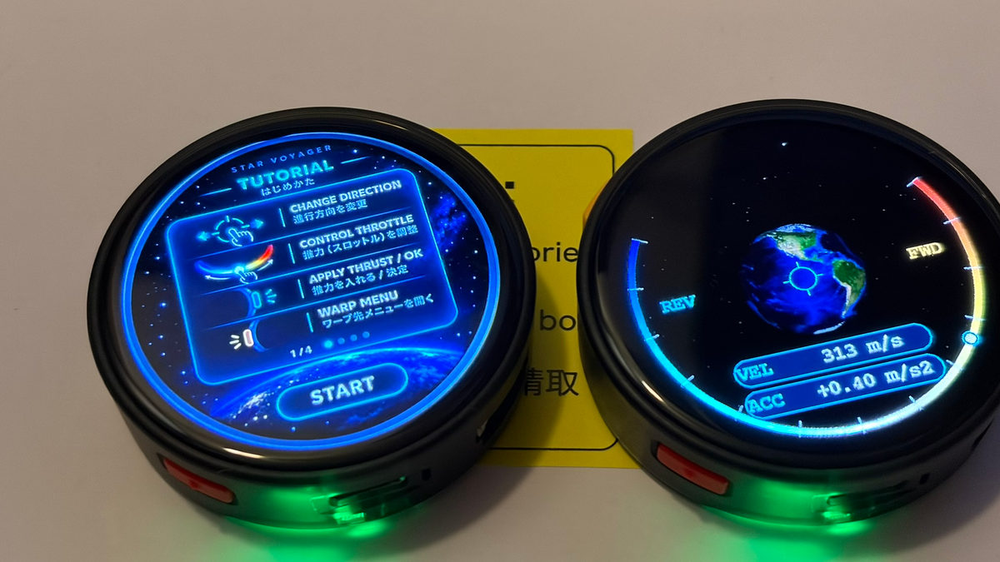

# voygerM5 — Space flight simulator for M5Stack StopWatch

Launched from Earth in 1977, Voyager 1 is still travelling into the distant reaches of space. **With voygerM5, you can meet Voyager 1 again—on the tiny screen of an M5Stack StopWatch.**

Explore planets, the Moon, and Voyager 1 and 2 in this spaceflight simulator, using gravity, thrusters, and warp travel.

## The voygerM5 Story

In November 2026, a mysteriously Doppler-shifted transmission arrived from the direction of the Magellanic Clouds. NASA traced it to **voygerM5**, an interstellar test craft launched forty years earlier. Months later it reappeared near the Moon, fitted with impossible new engines.

[Read the voygerM5 story](STORY.md) · [日本語版](STORY.ja.md)

## Controls
- Swipe center: change ship attitude (RCS).
- Swipe lower outer rim: throttle (left reverse / 6 o’clock neutral / right forward).
- Hold right button: main thrust.
- Left button: warp destinations; swipe to choose, right button to warp.
- Long press center: toggle HUD.

## Hardware & installation
- ESP32-S3R8, 16MB Flash, 8MB PSRAM, `BOARD_ID=30`.
- Paired libraries: M5Unified 0.3.0 / M5GFX 0.3.0.
- Independent StopWatch startup: `firmware/boards/voygerm5-stopwatch.json` and `firmware/src/main.cpp`; the first LCD frame is drawn directly before PSRAM sprite allocation. No external sample cloning or startup hook.
- Build: `BUILD_R16F8_NO_FLASH.cmd`; guarded APP-only flash: `RUN_R16F8_BUILD_FLASH_APP_ONLY_COM16.cmd COM13` (or `COM16` for another device). Despite its legacy filename, the script uses the supplied port.
- **Never assume an APP offset.** The guard reads the device's partition table and verifies the bootable APP, firmware size, and existing ESP32-S3 APP header. It supports one validated factory-only APP or recognized OTA layouts, writes only the current boot APP, and aborts on ambiguity. COM16 was confirmed with a single 3 MB `ota_0` at `0x20000`; a separate factory-only device may have a different target. Bootloader, partition table, OTA data, NVS and storage are never rewritten.

[日本語](README.ja.md) · [License](LICENSE) · [Asset notices](THIRD_PARTY_NOTICES.md)

## Source code / ソース

- [Browse firmware source](firmware/src/main.cpp) / [ワープ表示タイミング](firmware/include/warp_timing.hpp)
- [Download full R16 FIX8 source archive](source/SV_R16F8_WARP_FX_COM16.zip)
