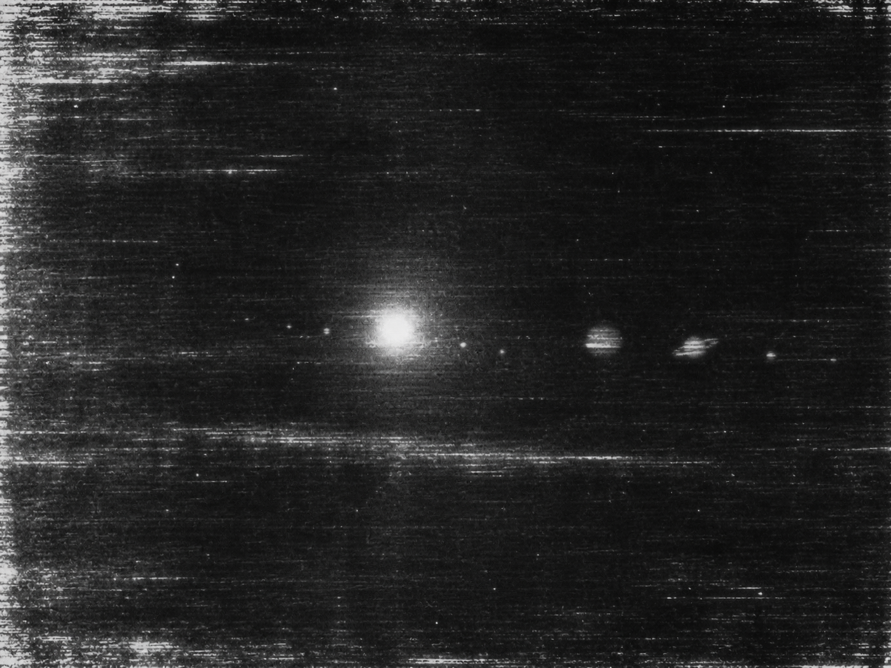

# 恒星間亜光速航行試験船 voygerM5号
*― 宛先、間違ってませんか？ ―*

## 起 ― 謎の電波

2026年11月。ハワイの天文台が、マゼラン雲の方向から届く奇妙な電波を観測した。

信号には強烈な相対論的ドップラーシフトが認められた。極端な青方偏移によって高周波側へ押し上げられ、時間的にも圧縮されたデータを復元すると、そこには遠方から撮影された太陽系の映像が記録されていた。小さく輝く太陽と、その周りに浮かぶ惑星たち。

映像は少しずつ近づいている。

**何かが太陽系へ向かっている。**

## 承 ― 40年前の宇宙船

NASAの解析により、信号に含まれる識別コードが判明した。

発信元は1986年に打ち上げられた無人の**恒星間亜光速航行試験船 voygerM5号**だった。

voygerM5号は、当時の対消滅推進技術を用い、長期間にわたる微弱な加速で恒星間航行を試みた実験機である。

> *計画の最終段階では、約4.5光年先の惑星に機体を衝突させることになっていた。衝突時に生じる閃光と高エネルギー放射を地球から観測し、機体の到達と最終速度を確かめる。それが、航行試験の完了条件だった。*
>
> *船体には、かつてのVoyager計画の伝統を受け継ぎ、まだ見ぬ知的生命に向けたメッセージが記されていた。しかし計画担当者たちは、その言葉が実際に誰かに読まれるとは考えていなかった。*

打ち上げから40年。計画どおりなら、太陽系をはるかに離れ、約4.5光年先の惑星近傍を航行しているはずだった。

その距離から、限られた送信電力の古い通信装置でこれほど鮮明な映像を送ってくるとは考えられない。しかも、解析された周波数の変化は、発信元が太陽系へ猛烈な速度で接近していることを示していた。

**しかし、voygerM5号に帰還計画はなかった。**

## 転 ― 帰ってきた実験機

数か月後。

地球と月の間、地球―月系の第1ラグランジュ点（L1）付近に、突如として人工物体が出現した。

それは、間違いなくvoygerM5号だった。

古びた円筒形の船体も地球の標章も、出発時のまま。しかし後部には、見覚えのない巨大な中空リングが幾重にも取り付けられていた。

NASAは調査機を接近させ、未知の推進装置の解析を始めた。

多段の反応器の形状と高エネルギー放射から、反物質を利用した推進装置ではないかと推測された。理論上の最大加速度は**240,000 m/s²**。低速域なら、わずか1秒で速度が秒速240km増す計算になる。

しかもvoygerM5号は、通常の航行とは別に、位置を不連続に変える能力まで持っていた。

40年前の地球製航法コンピューターと推進装置は残っていた。その後ろに、まるで誰かが親切に増設したかのように、未知の技術が接続されていた。

科学者たちはその装置の解析に夢中になった。

## 結 ― 写真

NASAは調査機が撮影したvoygerM5号の写真を公開した。

巨大な反応リング。青紫に輝く多段の推進装置。材質すら分からない接合部。世界中の研究者が写真の後部に注目した。

ところが、写真を見た人々が先に気づいたのは、**船体の側面**だった。

そこには40年前、人類が書き残したメッセージと、あとから書き加えられた返事があった。

> すべての**<u>知的生命</u>**へ  
> 私たちは惑星・地球から来ました。  
> 私たちは平和的な目的でやって来ました。  
> いつの日か、あなたたちに会えることを願っています。

> **宛先、間違ってませんか？**

---

*※この物語はフィクションです。実在の人物・団体・商品名・宇宙船、そして異星人とは一切関係ありません。*
