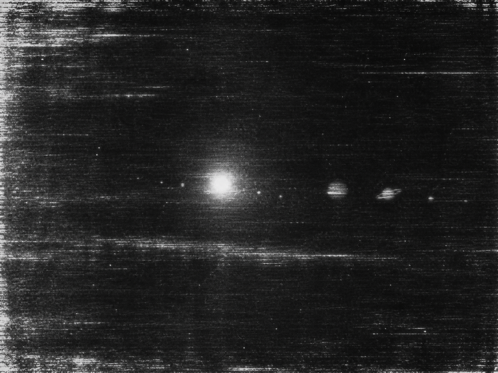

# voygerM5 — Interstellar Sublight Test Vehicle
*— Are You Sure You Have the Right Address? —*

## Beginning — A Signal from the Dark

November 2026. An observatory in Hawaii detected an unusual radio signal arriving from the direction of the Magellanic Clouds.

The signal showed an extreme relativistic Doppler shift. Its frequency was pushed far upward by the blueshift, and when analysts reconstructed the time-compressed data, they found a video: the Solar System seen from far away, the Sun a distant point of light surrounded by its planets.

The view was growing closer.

**Something was coming toward the Solar System.**

## Development — A Ship from Forty Years Ago

NASA identified a code embedded in the transmission.

It belonged to **voygerM5**, the unmanned Interstellar Sublight Test Vehicle launched in 1986.

Built to test a primitive antimatter propulsion system, voygerM5 had been designed to accelerate gently over many years on a voyage toward another star.

The final phase of the experiment called for the spacecraft to strike a planet roughly 4.5 light-years away. Observatories on Earth would watch for the flash and high-energy radiation from the impact, using them to confirm its arrival and estimate its final velocity. That was how the test was supposed to end.

In keeping with the tradition of the Voyager missions, a greeting to any intelligent life had been painted on its hull. But the mission planners had never expected anyone to read it.

Forty years later, it should have been far beyond the Solar System, near a planet roughly 4.5 light-years away.

Its aging, low-power transmitter should not have been able to deliver such clear footage from that distance. More puzzling still, the Doppler shift suggested that the source was approaching the Sun at tremendous speed.

**Yet voygerM5 had never been designed to return.**

## Turn — An Unexpected Arrival

A few months later, an artificial object appeared without warning near the Earth–Moon L1 Lagrange point, between Earth and the Moon.

It was unmistakably voygerM5.

The worn cylindrical hull and the insignia from Earth were still there. But a sequence of immense hollow rings had been fitted to the rear of the spacecraft.

NASA dispatched a probe for a close inspection.

Judging from the staged reactor chambers and their high-energy emissions, scientists suspected an advanced form of antimatter propulsion. Its estimated maximum acceleration was **240,000 m/s²**—enough, at low speeds, to add 240 kilometres per second to the ship's velocity in a single second.

That was not all. The vessel appeared able to change its position without traversing the space between.

Its original Earth-built guidance computer and engine were still present. The extraordinary machinery had simply been attached behind them, as if someone had thoughtfully upgraded an old appliance.

The scientists concentrated on the machinery.

## Ending — The Photograph

NASA released the probe's photographs.

Researchers around the world studied the enormous reaction rings, the blue-violet glow, and the seemingly impossible engineering.

But members of the public noticed something else on the **side of the hull**.

There, alongside a message painted by people on Earth forty years earlier, someone had left a reply directly on the hull.

---

*This story is a work of fiction. It is not affiliated with any real people, organizations, products, spacecraft—or extraterrestrials.*
